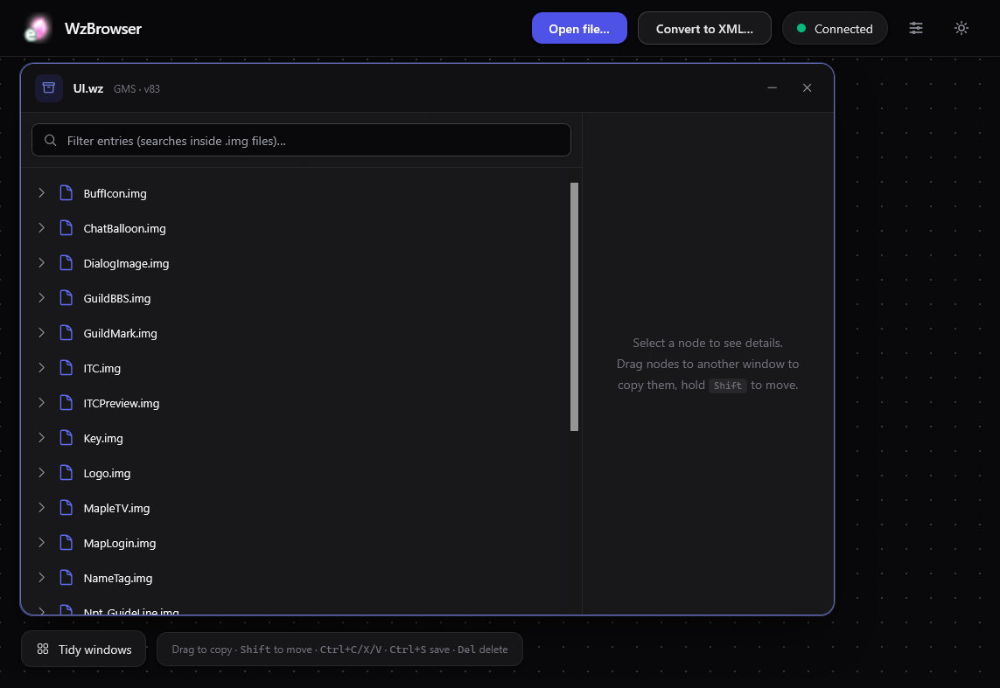

# WzBrowser

Browse and edit MapleStory `.wz` files in your web browser.



It comes in two parts:

| Part | What it is |
|---|---|
| **API** (`WzBrowser.Api` → `WzBrowser.exe`) | A small Windows program that reads and writes `.wz` files on your computer, using [MapleLib](https://github.com/lastbattle/MapleLib). |
| **Web app** (`WzBrowser.Web`) | The page you use. It's a static site and talks to the API. |

## Quick start

```powershell
git -c core.longpaths=true clone --recurse-submodules https://github.com/izarooni/WzBrowser.git
cd WzBrowser
build.bat                  # builds both into dist\
dist\WzBrowser.exe         # start the API on http://127.0.0.1:5178
```

Then open the web app. `cd WzBrowser.Web` then `npm run dev` serves it on http://localhost:5173, or host `dist\wwwroot` anywhere. Click **Open file…** and pick a `.wz` file.

You need the .NET 10 SDK and Node.js to build. MapleLib is a git submodule, and `build.bat` fetches it for you.

## Running the API

```powershell
WzBrowser.exe [--port 5178] [--host 127.0.0.1] [--root FOLDER] [--allow-origin URL]...
```

| Argument | Environment variable | Default | What it does |
|---|---|---|---|
| `--port N` | `WZBROWSER_PORT` | `5178` | Port to listen on. If it's busy, the next free one is used. |
| `--host ADDR` | | `127.0.0.1` | Address to listen on. |
| `--root FOLDER` | `WZBROWSER_ROOT` | none | Pin the server to a library folder (see below). |
| `--allow-origin URL` | `WZBROWSER_ORIGINS` (comma separated) | none | Let a web app hosted at that address call the API. You can repeat it. `localhost` is always allowed. |

### Library folder (`--root`)

Without a root, the web app can browse your whole disk to open files. With a root:
- only `.wz` files inside that folder can be opened or saved to;
- **Open file…** shows a searchable list of them;
- extra tabs appear for the whole library: Skills, Mobs, Maps, Items and NPCs.

You can also set the root in `appsettings.json` next to the exe instead of on the command line:

```json
{ "WzBrowser": { "Root": "D:\\Game\\Data" } }
```

## Running the web app

```powershell
cd WzBrowser.Web
npm install
npm run dev              # development server on http://localhost:5173
npm run build            # static site in build/client
npm run preview          # serve build/client on http://localhost:4173 (npm run preview -- 8080 for another port)
```

The web app connects to `http://127.0.0.1:5178` unless one of these changes it (later ones win):
1. `VITE_API_URL` at build time.
2. A `config.json` next to `index.html` on the hosted site, which needs no rebuild:
   ```json
   { "apiBase": "https://wz-api.example.com" }
   ```
   `"/"` means "this site's own address" (for an API behind a proxy, see below).
3. The address each user sets in the app (sliders icon). This option is hidden when the API has a library folder.

If you host the web app on another address, start the API with `--allow-origin https://your.site`. Safari blocks HTTPS pages from calling `http://127.0.0.1`, so use it from `http://localhost` there. Serve `index.html` and `sw.js` with `Cache-Control: no-cache` so updates reach users. The project path must not contain `#`.

## Sharing a read-only library

To let other people browse your files without changing them:

1. **Pin the API to a folder.** Put this `dist\appsettings.json` next to the exe:
   ```json
   { "WzBrowser": { "Root": "D:\\Game\\Data" } }
   ```
2. **Host the web app**, `dist\wwwroot`, with a `config.json` in it that points the app at its own site:
   ```json
   { "apiBase": "/" }
   ```
3. **Forward `/api/` to the API** from the same web server, and make sure it sends `X-Forwarded-For`. For nginx:
   ```nginx
   location /api/ {
       proxy_pass http://127.0.0.1:5178;
       proxy_set_header X-Forwarded-For $remote_addr;
   }
   ```
   IIS with URL Rewrite + ARR sends the header by itself.

Anyone who comes through the proxy, or from another computer, is then **view only**:
- they can open the quest and Commodity (Cash Shop) views and the library tabs;
- they can't see the raw tree, and can't edit, save or close files;
- the header shows *View only*.

There is no login, so anyone who can reach the site can view the library. To make changes, use the web app on the server itself, pointed at `http://127.0.0.1:5178`.

## Using the web app

Each opened file is a window on a canvas that you can pan by dragging or scrolling. You can move, resize and collapse the windows.

| Action | How |
|---|---|
| Copy a node to another window | Drag it onto a folder or image (hold **Shift** to move it instead) |
| Copy / cut / paste / delete | **Ctrl+C / Ctrl+X / Ctrl+V / Delete** |
| Edit a property | Click its name or value in the detail pane. **Enter** saves, **Esc** cancels. |
| More actions | Right-click a node: new property, copy path, save as PNG, export all images |
| Replace an image | Select a canvas, then **Replace…** in the detail pane (or drop an image file on its preview). Pick the quality to store it in next to the button. |
| Save | **Ctrl+S** |
| Discard edits | Undo button in the window's title bar |

**Edits stay in memory until you save. Saving always writes a new file** (`Map.edited.wz`, `Map.edited2.wz`, …), never touching the original.

Some files get views of their own (a **Raw tree** tab is always next to them):
- **Quests** (`Quest.wz` or `QuestData`): a searchable quest list with requirements, dialogue and rewards. Item, NPC, mob, map and skill names link to their files and show a picture on hover.
- **Commodity** (`Etc.wz`): the Cash Shop list as an editable table. You can sort, search, select a range with Shift-click, add entries (SN generated as in [CashCommodities](https://github.com/izarooni/CashCommodities)) and delete them.

**Convert to XML…** in the header writes `.wz` files out as server XML.

## Using it from Claude (MCP)

The API also serves an [MCP](https://modelcontextprotocol.io) server at `/mcp`, so Claude can read and edit files in bulk. Claude works on the same open files as the web app, so its edits show up there as unsaved changes.

Register it with Claude Code **once**:

```powershell
claude mcp add --scope user --transport http wzbrowser http://127.0.0.1:5178/mcp
```

Claude Code saves this, so you don't run it again when you restart the API. Without `--scope user`, it's only saved for the folder you ran it in.

After that, just have `WzBrowser.exe` running whenever you use Claude with it; Claude connects when a session starts. If the API wasn't running then, start it and reconnect with `/mcp` in Claude Code.

Re-run the command only if the address changes. For example, if port 5178 is busy the API picks the next free one, so check the `MCP server:` line it prints at startup. Start it with `--port` to keep the address fixed. To replace the saved address, run `claude mcp remove wzbrowser --scope user`, then add it again.

| Tool | What it does |
|---|---|
| `wz_library`, `wz_list_files`, `wz_open`, `wz_close` | Find, open and close files |
| `wz_children`, `wz_get_nodes` | Read nodes. `wz_get_nodes` reads many paths at once, with their subtrees. |
| `wz_search` | Find nodes by name in open files, or in every `.wz` in a folder |
| `wz_batch` | Many `set` / `rename` / `create` / `delete` / `copy` / `move` steps across files in one call. **All or nothing**: if one step fails, the rest are undone. `dryRun` checks without changing anything. |
| `wz_save`, `wz_revert` | Save to a new file, or discard edits |
| `wz_quests`, `wz_quest`, `wz_commodity`, `wz_set_commodity` | The quest and Cash Shop views |

The MCP server only answers programs on the same computer.
