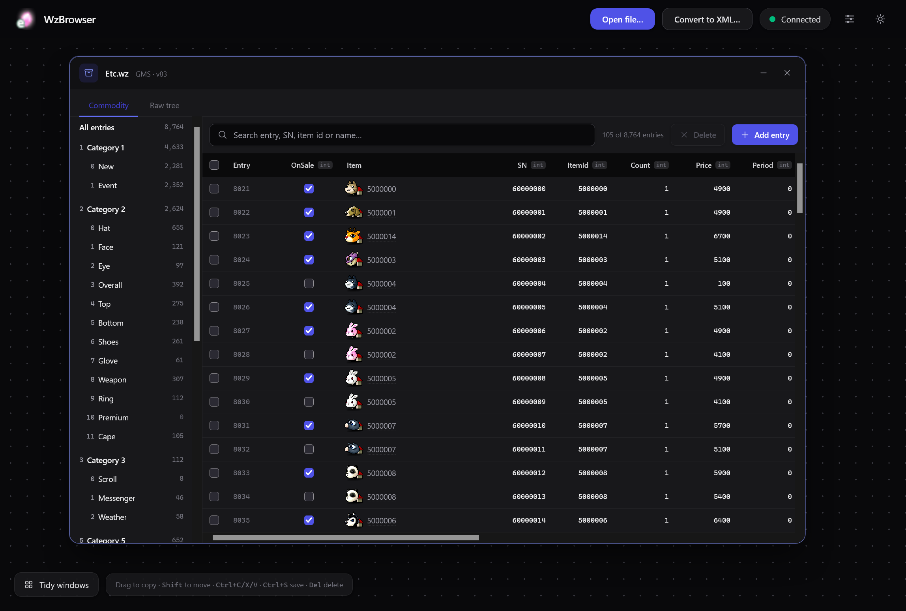
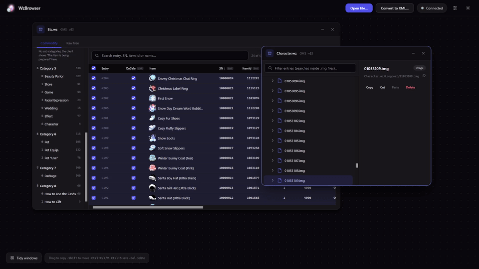
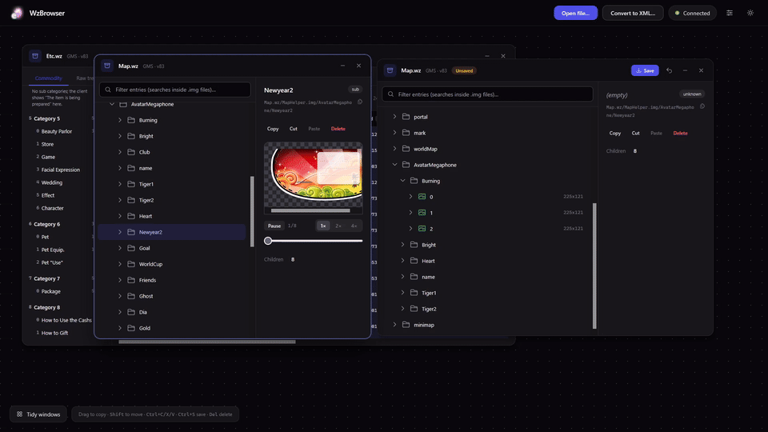
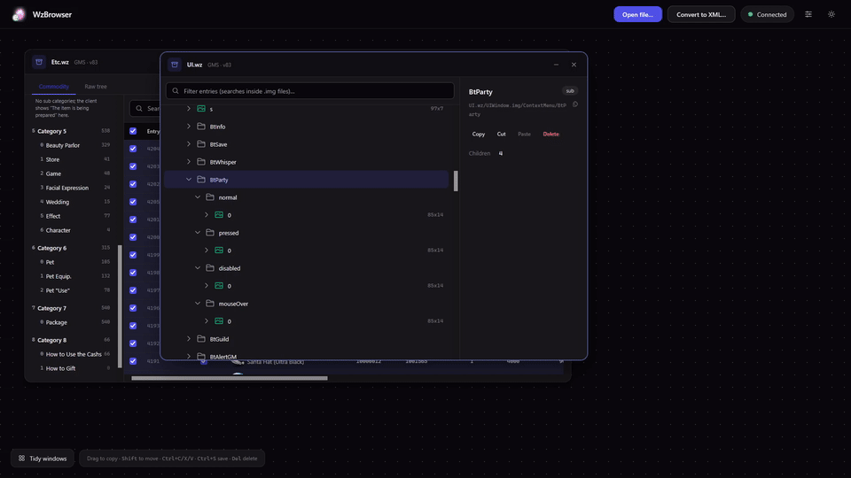

# WzBrowser

Browse and edit `.wz` files in your web browser.

It comes in two parts:

| Part | What it is |
|---|---|
| **API** (`WzBrowser.Api` → `WzBrowser.exe`) | A small Windows program that reads and writes `.wz` files on your computer, using [MapleLib](https://github.com/lastbattle/MapleLib). |
| **Web app** (`WzBrowser.Web`) | The page you use. It's a static site and talks to the API, can be hosted anywhere. |

## Quick start

```powershell
git -c core.longpaths=true clone --recurse-submodules https://github.com/izarooni/WzBrowser.git
build.bat                  # builds the API and web app into dist\
dist\WzBrowser.exe         # starts the API on http://127.0.0.1:5178
npm run dev                # in WzBrowser.Web: serves the web app on http://localhost:5173
```

Open the web app, click **Open file…** and pick a `.wz` file. You need the .NET 10 SDK and Node.js to build.

## Running the API

```powershell
WzBrowser.exe [--port 5178] [--host 127.0.0.1] [--root FOLDER] [--allow-origin URL]...
```

| Argument | Environment variable | Default | What it does |
|---|---|---|---|
| `--port N` | `WZBROWSER_PORT` | `5178` | Port to listen on. If it's busy, the next free one is used. |
| `--host ADDR` | | `127.0.0.1` | Address to listen on. |
| `--root FOLDER` | `WZBROWSER_ROOT` | none | Pin the server to a library folder (see below). |
| `--allow-origin URL` | `WZBROWSER_ORIGINS` (comma separated) | none | Let a web app hosted at that address call the API. You can repeat it. `localhost` is always allowed. |

### Library folder (`--root`)

Without a root, the web app can browse your whole disk to open files. With a root:
- only `.wz` files inside that folder can be opened or saved to;
- **Open file…** shows a searchable list of them;
- extra tabs appear for the whole library: Skills, Mobs, Maps, Items and NPCs.

You can also set the root in `appsettings.json` next to the exe instead of on the command line:

```json
{ "WzBrowser": { "Root": "D:\\Game\\Data" } }
```

## Running the web app

```powershell
npm install
npm run dev              # development server on http://localhost:5173
npm run build            # static site in build/client
npm run preview          # serve build/client on http://localhost:4173 (npm run preview -- 8080 for another port)
```

The web app connects to `http://127.0.0.1:5178` unless one of these changes it (later ones win):
1. `VITE_API_URL` at build time.
2. A `config.json` next to `index.html` on the hosted site, which needs no rebuild:
   ```json
   { "apiBase": "https://wz-api.example.com" }
   ```
3. The address each user sets in the app (sliders icon). This option is hidden when the API has a library folder.

Serve `index.html` and `sw.js` with `Cache-Control: no-cache` so updates reach users. The project path must not contain `#`.

### Hosting the web app on a domain (`--allow-origin`)

The web app runs in each user's browser and calls the API directly, so the API only answers pages it trusts. `localhost` and `127.0.0.1` are always trusted. If you host `dist\wwwroot` somewhere else, for example behind nginx at `http://wz.example.com`, the browser marks every API request as coming from that address and the API refuses it until you allow it:

```powershell
WzBrowser.exe --allow-origin http://wz.example.com
```

The value must match the address in the browser's address bar exactly: scheme (`http` vs `https`), domain, and port if it isn't the default (`http://wz.example.com:8080`). No path and no trailing slash is needed. Repeat the flag, or comma-separate `WZBROWSER_ORIGINS`, to allow several addresses (e.g. both `http://` and `https://`, or with and without `www.`).

Chrome and Edge may ask each user to allow the site to reach devices on their local network the first time; they need to accept. Safari blocks `https://` pages from calling `http://127.0.0.1`, so Safari users need the site on `http://`.

## Using the web app


The **Commodity** tab of `Etc.wz` shows the Cash Shop list as an editable table.




Each opened file is a window on a canvas. Pan by dragging the background (or with the middle mouse button anywhere), and move, resize or collapse windows.



Drag a node from one window onto a folder or image in another to copy it (hold **Shift** to move it instead). Select a node and press **Delete** to remove it. Edits stay in memory until you press **Ctrl+S**, which always writes a new file (`Map.edited.wz`, …) and leaves the original untouched.



Right-click a node and choose **Export all images** to save every canvas under it as PNGs in one go.

## Using it from Claude (MCP)

The API also serves an [MCP](https://modelcontextprotocol.io) server at `/mcp`, so Claude can read and edit files in bulk. Claude works on the same open files as the web app, so its edits show up there as unsaved changes.

Register it with Claude Code **once**:

```powershell
claude mcp add --scope user --transport http wzbrowser http://127.0.0.1:5178/mcp
```

Claude Code saves this, so you don't run it again when you restart the API. Without `--scope user`, it's only saved for the folder you ran it in.

After that, just have `WzBrowser.exe` running whenever you use Claude with it; Claude connects when a session starts. If the API wasn't running then, start it and reconnect with `/mcp` in Claude Code.

Re-run the command only if the address changes. For example, if port 5178 is busy the API picks the next free one, so check the `MCP server:` line it prints at startup. Start it with `--port` to keep the address fixed. To replace the saved address, run `claude mcp remove wzbrowser --scope user`, then add it again.

| Tool | What it does |
|---|---|
| `wz_library`, `wz_list_files`, `wz_open`, `wz_close` | Find, open and close files |
| `wz_children`, `wz_get_nodes` | Read nodes. `wz_get_nodes` reads many paths at once, with their subtrees. |
| `wz_search` | Find nodes by name in open files, or in every `.wz` in a folder |
| `wz_batch` | Many `set` / `rename` / `create` / `delete` / `copy` / `move` steps across files in one call. **All or nothing**: if one step fails, the rest are undone. `dryRun` checks without changing anything. |
| `wz_save`, `wz_revert` | Save to a new file, or discard edits |
| `wz_quests`, `wz_quest`, `wz_commodity`, `wz_set_commodity` | The quest and Cash Shop views |

The MCP server only answers programs on the same computer.
